# 🕵️‍♂️ Práctica: Identificación de Problemas en los Datos

> **⏱️ Duración:** 2 horas  
> **🎯 Nivel:** Cero a principiante  
> **🤖 Área:** Machine Learning (Data Cleaning)  
> **💻 Herramientas:** Python, VS Code, Pandas, NumPy, Seaborn  

---

## 🎯 Propósito de la Práctica
Que los estudiantes aprendan a revisar conjuntos de datos (*datasets*) e identifiquen los problemas más comunes que pueden arruinar el entrenamiento de un modelo de Machine Learning.  

# Oscar Flores NC = 1389

# Asegurar que la carpeta de resultados exista
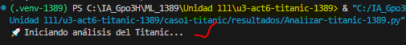
# 1. Cargar el archivo CSV
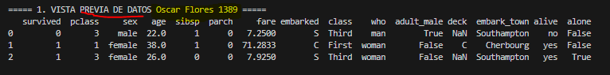
# 2. Conocer las dimensiones
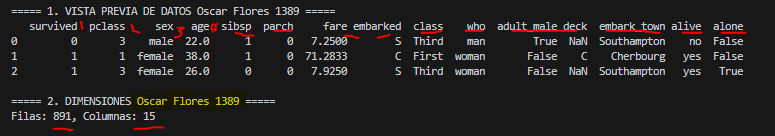
# 3. Revisar los tipos de datos
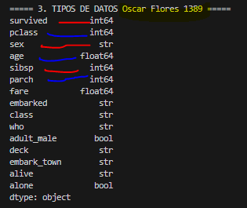
# 4. Identificar y contar datos nulos
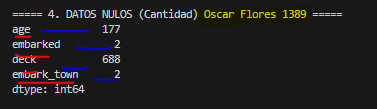
# 5. Calcular porcentaje de datos nulos
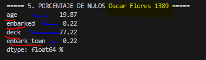
# 6. Identificar registros duplicados
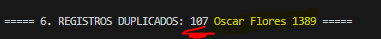
# 7. Detección de Valores Atípicos (Outliers) en la Edad usando IQR
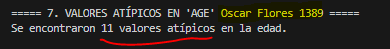
# 8. Visualización de datos nulos (Heatmap)
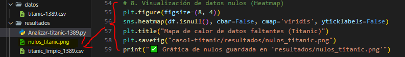
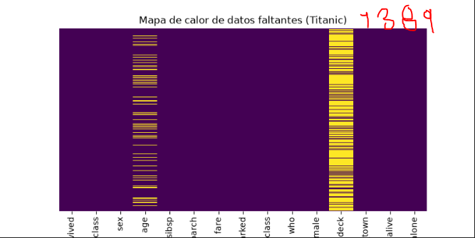
# 9. Limpieza básica (Copia para no alterar el original)
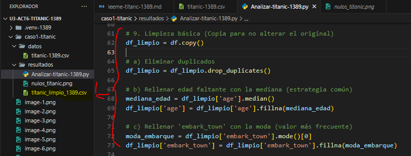
# 10. Guardar el dataset limpio
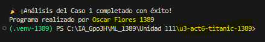